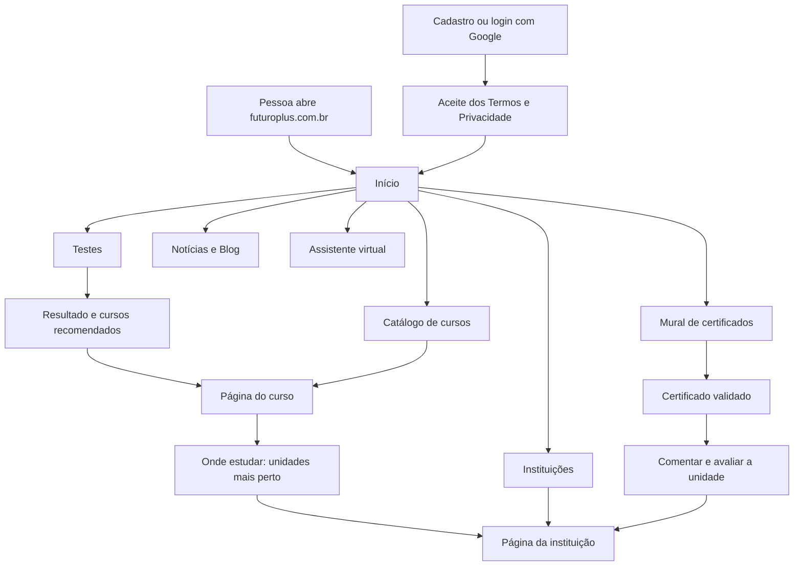
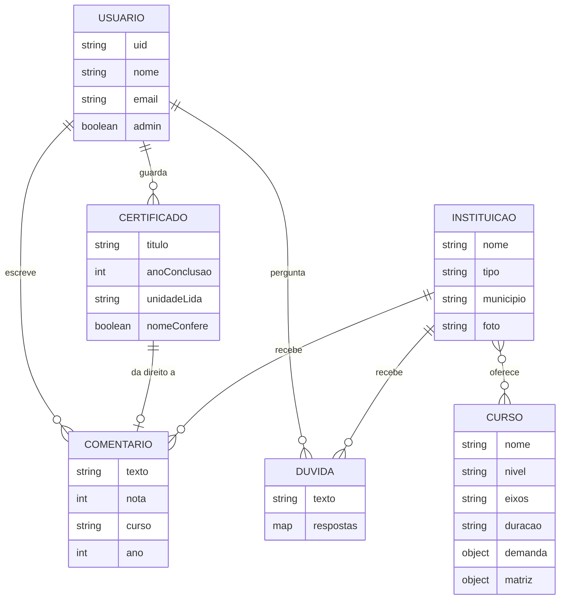

# Futuro+ 🚀

O **Futuro+** é uma plataforma gratuita de orientação vocacional e profissional para quem quer estudar nas **Etecs e Fatecs** do Centro Paula Souza. Num só lugar, dá para descobrir afinidades, comparar cursos técnicos e superiores de tecnologia, achar a unidade mais perto de casa, ler o que diz quem já estudou lá e acompanhar as notícias dos vestibulinhos.

O projeto foi desenvolvido como **Trabalho de Conclusão de Curso (TCC)**.

🌐 **Acesse: [futuroplus.com.br](https://futuroplus.com.br)**

📸 Instagram: [@futuroplus_](https://www.instagram.com/futuroplus_) · 💼 LinkedIn: [futuroplus](https://www.linkedin.com/in/futuroplus)

---

## Sumário

- [O que dá para fazer no site](#-o-que-dá-para-fazer-no-site)
- [Área administrativa](#-área-administrativa)
- [Tecnologias](#-tecnologias)
- [Estrutura do repositório](#-estrutura-do-repositório)
- [Como rodar o projeto](#-como-rodar-o-projeto)
- [Publicação](#-publicação)
- [Custos](#-custos)
- [Fluxo do site](#-fluxo-do-site)
- [Modelo de dados](#-modelo-de-dados)

---

## 🌟 O que dá para fazer no site

### 🧭 Descobrir o perfil
- **Teste Vocacional** completo, com o resultado guardado no perfil (precisa de conta).
- **Teste rápido das inteligências múltiplas** (teoria de Howard Gardner), em dois formatos: por afinidades ou por perguntas diretas. Os dois chegam ao mesmo resultado.
- **Central de Testes**, para rever os resultados sem refazer, e arte pronta para compartilhar nos stories.
- **Cursos recomendados de verdade:** o resultado é cruzado com o catálogo real das Etecs e Fatecs, respeitando pré-requisitos, eixos e as regras das especializações, em vez de indicar só uma área genérica.

### 📚 Escolher o curso
- **Catálogo** de cursos técnicos (Etec) e superiores de tecnologia (Fatec), com busca e filtros.
- **Página de cada curso:** o que se aprende, o que o profissional faz, onde trabalhar, duração e carga horária.
- **Demanda do vestibulinho:** candidatos por vaga e o histórico dos últimos semestres, coletados do site oficial.
- **Matriz curricular interativa:** as disciplinas por semestre ou módulo, com horas, eixos e certificações. Na Etec, cada forma de oferta (técnico, M-Tec…) ganha uma aba. O PDF oficial do plano de curso também fica disponível.
- **Onde estudar:** as unidades que oferecem o curso, em ordem de distância para quem tem endereço no perfil.

### 🏫 Escolher onde estudar
- **Lista de instituições** com filtros por tipo, curso, modalidade e região, e ordem por proximidade.
- **Página da instituição:** foto da fachada (do site do CPS), endereço com link para o mapa, cursos oferecidos, **comentários e notas de quem estudou lá** (só com certificado validado no Mural) e **dúvidas** respondidas por quem estudou na unidade ou pela equipe.

### 🎓 Mural de certificados
- Envio do certificado em imagem ou PDF.
- Leitura automática (OCR) do nome, do curso, da unidade e do ano, conferida de novo no servidor.
- **CPF e RG cobertos automaticamente** antes de o certificado aparecer no mural.
- Cada certificado validado dá direito a comentar e avaliar a unidade onde a pessoa estudou.

### 📰 Notícias e Blog
- **Notícias de Etecs e Fatecs** buscadas sozinhas nos feeds oficiais e na imprensa. Elas só aparecem depois de aprovadas no painel, e as de outros sites saem do ar depois de 90 dias.
- **Blog do Futuro+:** notícias escritas pela equipe, com rascunho, aprovação obrigatória, agendamento, imagens com legenda, negrito e itálico.

### 🔔 Notificações
- Avisos no sino do topo e numa janela ao entrar, para quem tem conta, para visitantes ou para todo mundo.
- **Notificação push** no celular ou no computador, para quem ativar no perfil.

### 👤 Perfil e conta
- Login por e-mail e senha ou pelo Google, com aceite dos Termos de Uso e da Política de Privacidade (e novo aceite sempre que o texto muda).
- Perfil com progresso e próximo passo, formações do Mural, conquistas e instituições.
- Exclusão de conta com carência de 30 dias.

### 🤖 Assistente virtual
- Chatbot com vários agentes de IA que responde sobre editais, cotas, isenção de taxa, vagas, unidades mais próximas e notícias dos vestibulares. Ele busca na web e nos manuais oficiais do Centro Paula Souza.
- **Proteções:** só para quem tem conta, com limite de mensagens por dia e de tamanho da mensagem. Recusa assunto fora do vestibular e barra tentativas de *prompt injection* (mandar ignorar as instruções, trocar de papel, revelar o prompt), inclusive as escondidas nas páginas que a busca traz. A resposta só mostra link de site oficial e é barrada se vazar chave de API ou as instruções do assistente.

### ✨ E mais
- **Tour guiado** na primeira visita, com destaque nas principais telas.
- **Pronto para buscadores:** sitemap (com a página de cada curso e de cada instituição, gerada na hora), robots.txt, dados estruturados (schema.org) e descrição própria em cada página.
- **Páginas de curso e de instituição prontas:** uma função do Firebase (`pagina_pronta`) entrega `curso.html` e `instituicao.html` já com o título, a descrição, a prévia de link e o texto principal dentro do HTML. O Google lê tudo sem esperar o JavaScript, e o link compartilhado mostra o nome do curso ou da unidade.

---

## 🔐 Área administrativa

Restrita às contas marcadas como administradoras no Firestore. As páginas ficam em `admin-*.html` e não aparecem nos buscadores.

| Painel | O que faz |
|---|---|
| **Unidades** | Importa o CSV de unidades do CPS, busca as fotos da fachada e as logos e localiza cada unidade no mapa. |
| **Catálogo de cursos** | Importa o CSV oficial (mostrando antes o que muda), lê a matriz curricular do PDF (inclusive tabela em imagem, por OCR) e define as capas por eixo. |
| **Notificações** | Cria, agenda e ativa os avisos, com push opcional. |
| **Notícias** | Aprova o que a coleta trouxe e escolhe as notícias do carrossel da Início. |
| **Blog** | Editor das notícias do Futuro+, com aprovação e agendamento. |
| **Comunidade** | Mostra as avaliações e dúvidas novas e o histórico de tudo o que acontece nos comentários, inclusive o que foi apagado e por quem. |
| **Termos e Privacidade** | Edita os textos legais e publica uma nova versão. |

Notificações, Notícias, Blog e Comunidade guardam um histórico de quem fez o quê, que ninguém consegue apagar, com busca e filtros por data, pessoa e ação. Quem é admin também recebe um aviso quando alguém avalia um curso ou faz uma pergunta sobre uma instituição: no sino e, para quem ativou, por push.

---

## 🧰 Tecnologias

- **Site:** JavaScript puro (sem framework) com **Vite**. No navegador, **pdf.js** lê os PDFs e **Tesseract.js** faz o OCR.
- **Firebase:** Authentication, Firestore, Storage, Hosting, Cloud Messaging (push) e Cloud Functions.
- **Funções em Python** (`functions/`): assistente virtual (**OpenAI Agents SDK** + **Tavily**), coleta das notícias e da demanda, envio de imagens, histórico da comunidade, push, sitemap e tarefas agendadas.
- **Função em Node** (`functions-node/`): valida os certificados do Mural no servidor, também com Tesseract.js.
- **Apps:** **Kotlin Multiplatform** + **Compose Multiplatform** (Android e iOS), com o GitLive Firebase SDK. Foi a base onde o projeto começou; hoje a interface principal é o site.

---

## 📁 Estrutura do repositório

```text
Futuro-Plus/
├── webApp/                 site (Vite): páginas .html, assets/js, assets/css e public/
│   └── testes/             roteiros de teste com Firebase simulado (não entram no site)
├── functions/              Cloud Functions em Python
│   └── testes/             testes das funções, sem tocar no Firebase
├── functions-node/         Cloud Function em Node (validação dos certificados)
├── androidApp/ iosApp/ shared/   apps em Kotlin Multiplatform
├── firestore.rules         regras de segurança do Firestore
├── firestore.indexes.json  índices do Firestore
├── storage.rules           regras de segurança do Storage
└── firebase.json           configuração do Hosting, das funções e dos emuladores
```

---

## 💻 Como rodar o projeto

### Site
Precisa do Node.js 20.19 ou mais novo.

```bash
cd webApp
npm install
npm run dev
```

O site abre em `http://localhost:5173`. Sem login e sem os dados do Firestore, várias páginas ficam vazias. Para testar com login e dados simulados, abra `http://localhost:5173/404.html` e rode no console um dos roteiros de `webApp/testes`, por exemplo:

```js
await import('/testes/painel-cursos.js');
```

Cada roteiro explica no começo do arquivo o que ele monta e como usar.

### Funções em Python
Precisa do Python 3.10.

```bash
cd functions
python -m venv venv
venv/Scripts/pip install -r requirements.txt
```

No Linux ou no macOS, use `venv/bin/pip`. O assistente virtual precisa de um arquivo `functions/.env`, que não vai para o repositório:

```text
OPENAI_API_KEY=...
TAVILY_API_KEY=...
VECTOR_STORE_ID=...
```

Para rodar os testes das funções e das proteções do assistente, a partir da pasta do projeto:

```bash
functions/venv/Scripts/python.exe functions/testes/testar_funcoes.py
```

```bash
functions/venv/Scripts/python.exe functions/testes/testar_seguranca_chat.py
```

```bash
functions/venv/Scripts/python.exe functions/testes/testar_paginas_prontas.py
```

Para subir tudo localmente com os emuladores do Firebase:

```bash
npx firebase-tools emulators:start
```

### Demanda do vestibulinho
O site do vestibular bloqueia os pedidos que saem dos servidores do Google, então a demanda (candidatos por vaga) é atualizada por um script rodado no seu computador. Ele usa uma chave de conta de serviço do Firebase, que deve ficar fora da pasta do projeto e nunca ir para o repositório. As instruções completas estão no começo do arquivo. Da pasta `functions/`, com o venv ativado:

```bash
python atualizar_demanda_local.py --credencial "C:\caminho\para\chave.json"
```

### Função em Node (certificados)
Precisa do Node.js 22.

```bash
cd functions-node
npm install
```

### Apps Android e iOS
- **Android:** coloque o `google-services.json` em `androidApp/` e rode a configuração `androidApp` no Android Studio.
- **iOS:** coloque o `GoogleService-Info.plist` em `iosApp/`, abra `iosApp` no Xcode, instale as dependências pelo SPM e clique em Run.

---

## 🚀 Publicação

Tudo a partir da pasta do projeto. Primeiro, gere o site:

```bash
npm --prefix webApp run build
```

Depois publique só o que mudou, uma parte de cada vez:

```bash
npx firebase-tools deploy --only hosting
```

```bash
npx firebase-tools deploy --only functions
```

```bash
npx firebase-tools deploy --only firestore
```

```bash
npx firebase-tools deploy --only storage
```

- `hosting` publica o site (a pasta `webApp/dist`).
- `functions` publica as funções em Python e em Node.
- `firestore` publica as regras e os índices.
- `storage` publica as regras do Storage.

O build tira `curso.html` e `instituicao.html` da raiz de `webApp/dist` e guarda em `webApp/dist/modelos/`. No site, esses dois endereços são entregues pela função `pagina_pronta`, que usa os modelos. Por isso, quando uma mudança cria ou muda uma função usada pelo site (`pagina_pronta` ou `sitemap_dinamico`), publique as funções **antes** do hosting. No `npm run dev` nada muda: o Vite entrega as duas páginas direto.

---

## 💸 Custos

As Cloud Functions pedem o plano **Blaze** do Firebase, que cobra conforme o uso. O site, as funções e o banco são pensados para caber na cota gratuita. O assistente virtual usa a API da **OpenAI** e o **Tavily**, que são cobrados por uso.

---

## 🔀 Fluxo do site



---

## 🧩 Modelo de dados

As principais coleções do Firestore:



Além dessas, o projeto usa `noticias`, `noticias_fila` e `noticias_proprias` (notícias e Blog), `notificacoes` e `fcm_tokens` (avisos e push), `avisos_admin` e `comunidade_historico` (aviso para admins e histórico da comunidade), os históricos de cada painel e `configuracoes`. As coleções `demanda` e `chat_sessions` só são usadas pelo servidor. As regras de acesso de cada uma estão em `firestore.rules`.
